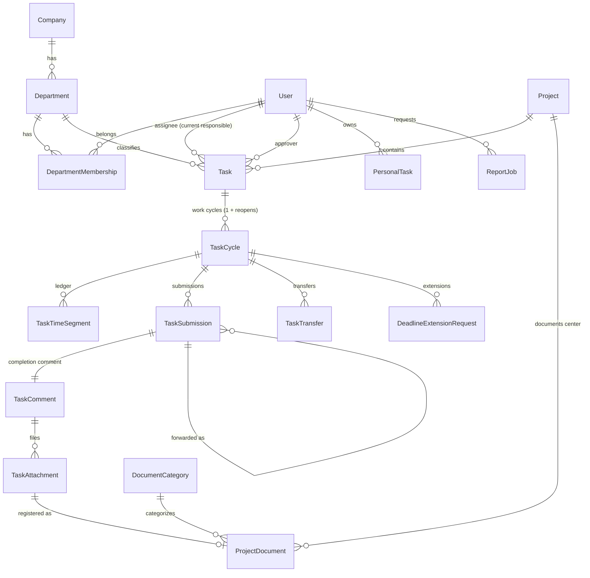
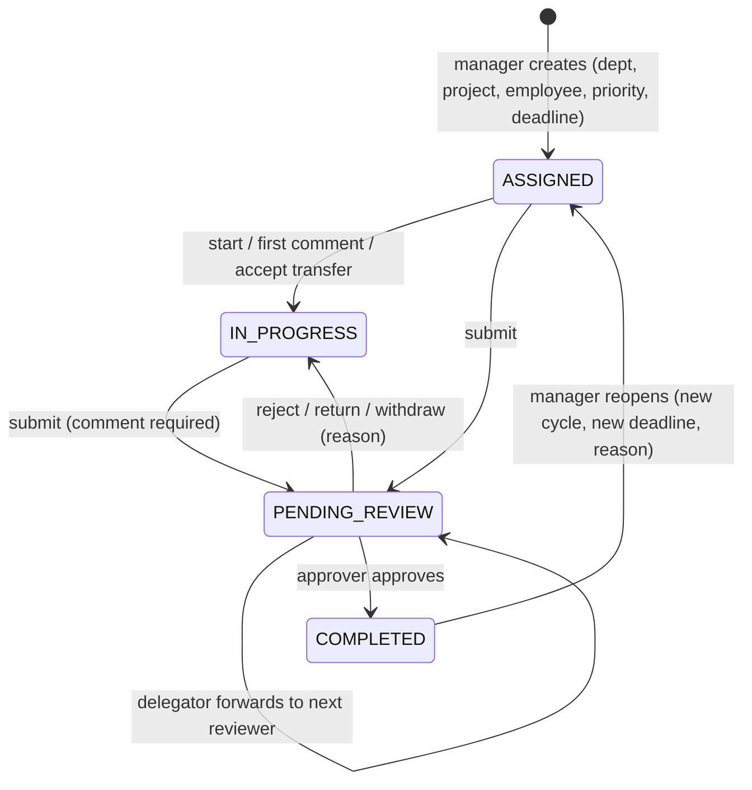
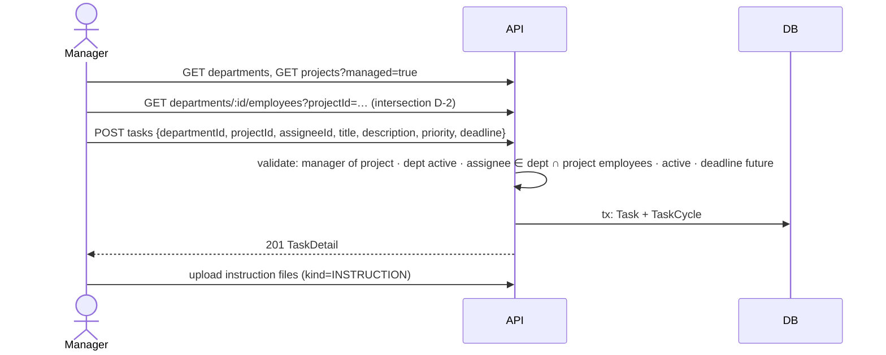
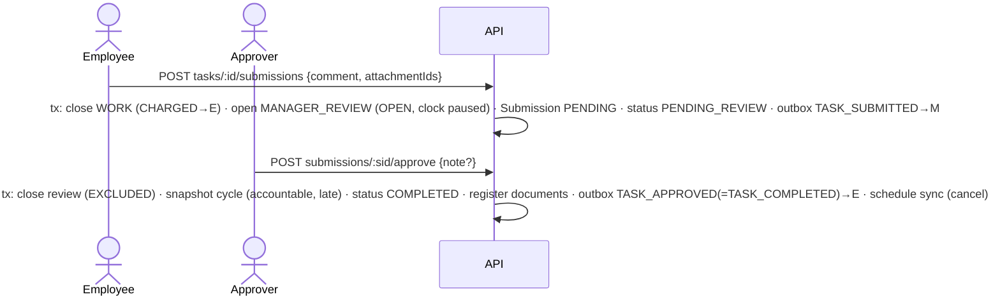
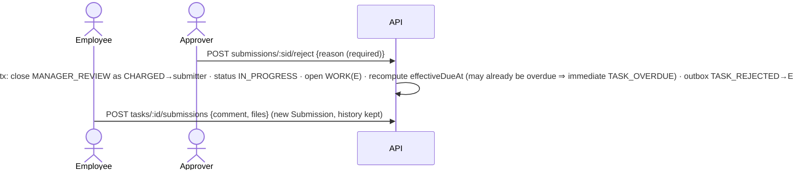
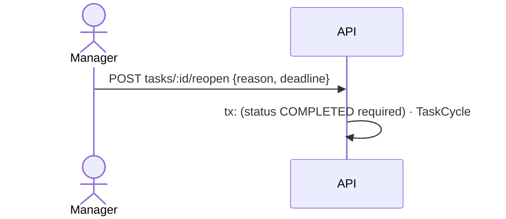
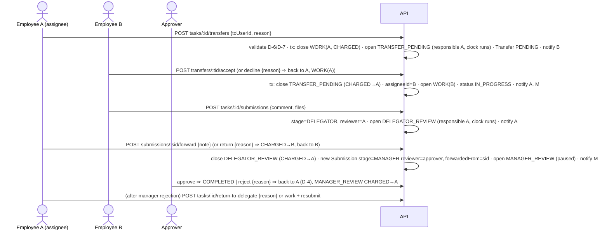
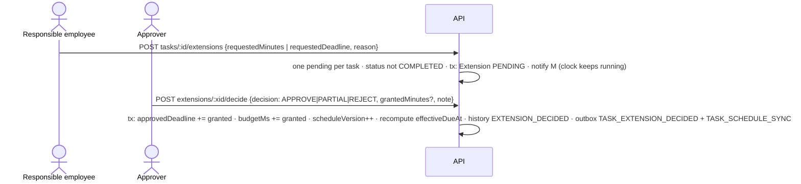

# Al-Rasiyat Enterprise Platform — Implementation Blueprint

Status: **planning only** (no code, schema, dependency or infrastructure change has been made). Date: 2026-11-16.
Baseline: commit `586e0bb` on `master`. Audience: the two implementation prompts that follow (Phase 1 backend, Phase 2 frontend/PDF/E2E).

Conventions used below: **MUST** = required for Definition of Done; **[D-n]** = business decision with a recommended default (section 0) that the implementer applies unless the product owner overrides it.

---

## 0. Decisions that need business confirmation (recommended defaults applied throughout)

| # | Question | Recommended default (used in this plan) | Why |
|---|---|---|---|
| D-1 | Can an employee belong to several departments? | **Yes, many-to-many** (`DepartmentMembership`), with one flagged `isPrimary` | Future-proof; engineers often sit in two units. Task creation filters by the chosen department. |
| D-2 | Must the assignee also be a member of the project? | **Yes — assignee = active EMPLOYEE member of the project AND active member of the department** (intersection). No auto-enrolment. | Keeps the existing project-scoped access model (employees only see their projects). |
| D-3 | Who is "the authorized manager" who approves? | **`Task.approverId`** (defaults to the creating manager). ADMIN may change it; ADMIN may also decide as audited break-glass. Other project managers can view but not decide. | "Original manager remains final authority"; avoids deadlock when a manager leaves (admin reassigns approver). |
| D-4 | Manager rejects a submission that came through a transfer chain — who gets it back? | **The employee who submitted to the manager** (top of the chain, the original assignee A). A may return it to the delegate (B) or finish it. The rejected review interval is charged to A. | A is accountable to the manager; mirrors the requested chain. |
| D-5 | Who is rated after a transferred task is approved? | **One rating per task (unchanged); subject = the original/accountable assignee A**; the report shows each employee's charged time. | Keeps "one rating per completed task" and averages unchanged; accountability sits with A. (Alternative: rate the performing delegate B.) |
| D-6 | Transfer depth | **Max 3 hops** in a cycle; a user may appear only once in a chain; the approver can never be a transfer target. | Prevents circular transfers and approval bypass. |
| D-7 | Eligible transfer targets | Active EMPLOYEE member of the **same project and the task's department**, not already in the chain, not the approver. | Same rules as assignment (D-2). |
| D-8 | Does the clock run while the manager reviews? | **Provisionally paused**. Confirmed at decision: approval ⇒ interval excluded; rejection ⇒ interval charged (retroactively). No reminders during manager review. | Directly implements examples 1 and 2. |
| D-9 | Visibility of documents registered from approved completions | **MANAGERS_ONLY by default**; manager may publish to PROJECT_MEMBERS. Manual uploads default PROJECT_MEMBERS (uploader may restrict). | Employees today cannot see other employees' tasks; documents must not leak them. |
| D-10 | How are temporary passwords delivered? | **Cognito generates & e-mails it** (never seen by our system). Optional admin-chosen "show once" mode returns a generated password exactly once in the create/reset response (no-store, never logged, not retrievable). | Satisfies "never store plaintext / never in ordinary responses". |
| D-11 | Rename `COMPANY_ADMIN` to `ADMIN`? | **Yes**, via `ALTER TYPE … RENAME VALUE` (non-destructive) + code rename in one release. `PROJECT_MANAGER` stays (shown as "Manager"). | Requested dedicated ADMIN role; COMPANY_ADMIN is already that role. |
| D-12 | Personal tasks: protection from DB operators? | App-level isolation (MUST) + **application-level encryption of title/notes** (KMS envelope key) **(SHOULD, Phase 1 M7)**. | "Not even administrators" — app admins are blocked by API; encryption also blocks casual DB access. |
| D-13 | Can an employee withdraw a pending submission? | **Yes, before a decision**; the review interval is charged to the submitter (same as rejection). | Prevents gaming the pause. |
| D-14 | Report rendering engine | **Headless Chromium (HTML → PDF) in the worker**, fonts embedded from the image. | Only option with correct Arabic shaping + bidi + RTL tables; reuses the design tokens. |
| D-15 | Legacy tasks without department | Backfill from the assignee's primary department if exactly one; else leave `departmentId` NULL ("غير مصنّف / Unassigned"); NOT NULL enforced for tasks created after cutover. | Preserves history without guessing. |

---

## Deliverable 1 — Existing Architecture Assessment

### 1.1 Modules (as implemented)

| Area | Location | What exists today |
|---|---|---|
| API (NestJS 11) | `apps/api/src` | `auth` (local JWT / Cognito, forgot/reset password, refresh, `/me`), `access` (central `AccessService`), `users` (invite, update, admin reset), `projects` (+ memberships), `tasks` (CRUD, start, comment, **complete (immediate)**, reopen, reassign, history), `attachments` (pre-signed upload/confirm/download), `ratings` (rate, performance summaries/detail), `notifications`, `push` (Web Push subscriptions), `realtime` (WebSocket + Postgres LISTEN), `dashboard`, `company` (settings, reminder offsets), `outbox`, `storage`, `health` |
| Worker | `apps/worker/src` | outbox relay → SQS, consumer `processor.ts`, `Notifier` (history + `PushDelivery`), Web Push transport, deadline scheduling (EventBridge / local DB), push maintenance, abandoned-upload cleanup, realtime publisher |
| Web (Next.js 15 PWA) | `apps/web/src` | Pages: `/login`, `/forgot-password`, `/` dashboard, `/projects`, `/projects/[id]`, `/tasks`, `/tasks/new`, `/tasks/[id]`, `/tasks/[id]/edit`, `/employees`, `/employees/[id]`, `/users` (Team), `/notifications`, `/settings`, `/settings/notifications`. BFF `/bff/*`, `/session/*`, service worker, design system, i18n (Arabic default), Asia/Riyadh formatting |
| Shared packages | `packages/*` | `database` (Prisma schema, migrations, seed, outbox event contracts), `validation` (zod 3), `config` (env + constants), `shared-types` (DTOs), `api-client` |
| Infra | `infrastructure/aws-cdk`, `docker/` | ECS Fargate (api, web, worker), ALB (HTTPS enforced for prod), Route 53/ACM, RDS PG16, S3, SQS+DLQ, EventBridge Scheduler, Cognito, Secrets Manager, CloudWatch alarms; Compose with LocalStack |
| Tests | | API 56, worker 40, web 34, validation 17, CDK 13, Docker smoke 17, Playwright E2E 15 (all green at baseline) |

### 1.2 Database entities (Prisma)
`Company` (timezone, reminderOffsetsMinutes) · `User` (role COMPANY_ADMIN/PROJECT_MANAGER/EMPLOYEE, locale, isActive, cognitoSub, passwordHash) · `Project` (ACTIVE/ARCHIVED) · `ProjectMembership` (MANAGER/EMPLOYEE, soft `removedAt`) · `Task` (single `assigneeId`, `createdById`, `deadline`, status ASSIGNED/IN_PROGRESS/COMPLETED, `startedAt`, `completedAt`, `completedLate`, `reopenCount`, `scheduleVersion`, `archivedAt`) · `TaskComment` (`isCompletionNote`) · `TaskAttachment` (PENDING/UPLOADED, optional `commentId`, `storageKey`) · `TaskRating` (1 per task) + `TaskRatingRevision` · `TaskHistory` (enum action + JSON metadata) · `Notification` (unique userId+dedupeKey) · `PushSubscription` · `PushDelivery` · `OutboxEvent` · `ScheduledEvent`.
CHECK constraints: rating 1–5; attachment size ≤ 25 MB; **`Task_completion_consistency` (COMPLETED ⇔ completedAt & completedLate NOT NULL)**; push subscription/delivery checks.

### 1.3 API endpoints (`/api/v1`)
Auth: `POST auth/login|new-password|forgot-password|reset-password|refresh`, `GET auth/me`, `PATCH me`.
Users: `GET users`, `POST users` (invite), `PATCH users/:id`, `POST users/:id/reset-password`.
Projects: `GET projects`, `GET projects/:id`, `POST projects`, `PATCH projects/:id`, `GET|POST projects/:id/members`, `DELETE projects/:id/members/:userId`.
Tasks: `GET tasks` (view, q, sort, projectId, assigneeId, status, page), `POST tasks`, `GET|PATCH tasks/:id`, `POST tasks/:id/reassign|start|complete|reopen`, `GET|POST tasks/:id/comments`, `GET tasks/:id/history`.
Attachments: `POST tasks/:taskId/attachments/upload-url`, `GET tasks/:taskId/attachments`, `POST attachments/:id/confirm`, `GET attachments/:id/download-url`.
Ratings: `GET|PUT tasks/:id/rating`, `GET performance/employees`, `GET performance/employees/:userId`.
Other: `GET dashboard`, `GET|PATCH company/settings`, notifications (list, unread-count, read, read-all), push (vapid key, subscribe, unsubscribe, status, test), `WS /realtime`, `GET /health`.

### 1.4 Permissions today
`AccessService`: COMPANY_ADMIN = everything in company; project MANAGER = their projects and all tasks there; project EMPLOYEE = project + only own tasks; foreign resources → 404. Ratings: role guard (admin/PROJECT_MANAGER) + task-manager access; employees never get rating data. Company role PROJECT_MANAGER alone grants nothing without memberships.

### 1.5 Workflows today
Create (manager) → ASSIGNED → start/comment → IN_PROGRESS → **employee completes immediately** (comment required, `completedLate = completedAt > deadline`) → COMPLETED → manager rates; reopen (new deadline, history keeps previous completion); reassign (open tasks only). Deadline reminders: offsets before `deadline` + overdue at `deadline`, versioned by `scheduleVersion`, re-checked in worker.

### 1.6 Reusable components
Outbox + SQS + Notifier (idempotent history, push, realtime), scheduler with versioning, AccessService patterns, attachment pipeline & S3 keys, TaskHistory, rating audit, i18n/RTL & Riyadh formatting, design system/components, Playwright + smoke harness, CDK constructs.

### 1.7 Missing capabilities
Departments, priority, PENDING_REVIEW & approvals, submissions as entities, time ledger/accountable time, transfers/delegation, extension requests, project documents center & categories, personal tasks, PDF reports & job pipeline, dedicated ADMIN naming, forced first-login change in **local** mode (Cognito already forces NEW_PASSWORD_REQUIRED), admin-set temporary passwords, notification preferences (only per-device push on/off exists).

### 1.8 Technical debt & conflicts with the new requirements

| # | Conflict | Impact | Resolution (milestone) |
|---|---|---|---|
| C-1 | Completion is immediate everywhere: `tasks.service.complete`, CHECK `Task_completion_consistency`, `TASK_COMPLETED` → managers, worker texts, ratings "awaiting rating", dashboard, E2E + smoke tests | Core workflow change | M3: submission entity; COMPLETED only on approval; constraint rewritten; tests rewritten |
| C-2 | Overdue = `deadline < now` in 6 places (mapper, task list view, dashboard, performance summary, worker reminder/overdue checks) | Must use accountable time | M2: single `TimeLedgerService` + denormalized `effectiveDueAt`/`chargedMs`; all call sites switched |
| C-3 | Reminders keyed to wall-clock `deadline` (`computeDeadlineJobs`) | Pauses/extensions break timing | M2: schedule against `effectiveDueAt`; none while paused |
| C-4 | Single `assigneeId` drives access (`ASSIGNEE`) | Delegator A loses access after transfer | M4: `DELEGATOR` access from accepted transfers in current cycle |
| C-5 | Instruction files detected as `commentId IS NULL AND uploadedById != assigneeId` | Breaks when assignee changes/transfers | M1: explicit `TaskAttachment.kind` (INSTRUCTION, COMMENT, SUBMISSION) + backfill |
| C-6 | `completedLate` computed from wall time at completion | Must come from ledger at approval | M3: snapshot on `TaskCycle` at approval; `Task.completedLate` mirrors it |
| C-7 | `TaskHistory.metadata` is free JSON | Reports need structured facts | New typed tables (cycles, segments, submissions, transfers, extensions) are the source of truth; history stays the human timeline |
| C-8 | Role names `COMPANY_ADMIN` in code, seed, tests, CDK docs | Rename | M1 (D-11) |
| C-9 | Throttler is in-memory per API instance | Heavy report endpoints need shared limits | M9: DB-based per-user quotas for report jobs |
| C-10 | No server-side fonts/Chromium | PDF | Phase 2 P5 (image + memory changes) |
| C-11 | zod 3 advisory (accepted risk) | New large payloads (reports filters) | Keep strict `.max()`; body limit 100 KB; zod 4 migration remains backlog |
| C-12 | Web PWA caches old JS chunks until SW update | Old client calling changed `complete` semantics | API keeps `POST tasks/:id/complete` as alias of submit; responses carry new status; SW VERSION bump |

---

## Deliverable 2 — Updated System Architecture

No stack change. All new behaviour lives in the existing modular monolith + worker:

```mermaid
flowchart LR
  subgraph Web[Next.js PWA]
    UI[Pages + design system] --> BFF[/bff proxy/]
    UI <-. WebSocket .-> RT
  end
  BFF --> API
  subgraph API[NestJS API]
    AS[AccessService<br/>+ dept / delegation / personal rules]
    TL[TimeLedgerService]
    WF[TaskWorkflowService<br/>submit · review · transfer · extension]
    DOC[DocumentsService]
    PT[PersonalTasksModule<br/>owner-only]
    RP[ReportsService<br/>authorized dataset builder]
    ADM[Admin & Provisioning]
    RT[RealtimeService]
  end
  API -->|same $transaction| PG[(PostgreSQL)]
  API -->|outbox| PG
  W[Worker] -->|relay| SQS[(SQS)]
  SQS --> W
  W -->|schedules| EB[EventBridge Scheduler] --> SQS
  W --> PUSH[Web Push]
  W -->|pg_notify| PG
  W -->|render PDF (Chromium)| S3[(S3 private)]
  API -->|pre-signed| S3
  ADM --> COG[Cognito]
```

Integration rules:
1. **Every state transition** (submit, forward, approve, reject, return, withdraw, transfer request/accept/decline/cancel, extension request/decision, reopen, reassign, deadline edit) is one `$transaction` that: checks preconditions with a conditional update (409 on conflict), closes/opens ledger segments, updates denormalized time fields + `scheduleVersion`, writes `TaskHistory`, writes outbox events (`TASK_SCHEDULE_SYNC` + notification event). Rule 4/5 of CLAUDE.md unchanged.
2. `TaskWorkflowService` is a new service in `apps/api/src/tasks/` owning the state machine; `tasks.service.ts` keeps CRUD/list/detail.
3. `TimeLedgerService` (pure functions + DB adapter) is shared by API and worker via `packages/database/src/time-ledger.ts` (pure calculation, no Nest dependency) so both compute identically.
4. Documents and reports authorize in the API (AccessService); the worker only renders a stored, already-authorized dataset (keeps CLAUDE.md rule 1).
5. Personal tasks are a separate module, table and route prefix (`/me/personal-tasks`), never joined with `Task`, never published to dashboards, reports, realtime fan-out to others, or documents.
6. Notifications: new event types flow through the existing outbox → worker → Notifier (history first, push, realtime).

---

## Deliverable 3 — Database Design

### 3.1 ERD (new and changed entities)



### 3.2 New enums / enum changes
* `UserRole`: rename `COMPANY_ADMIN` → `ADMIN` (D-11).
* `TaskStatus`: add `PENDING_REVIEW` (ASSIGNED → IN_PROGRESS → PENDING_REVIEW → COMPLETED).
* `TaskPriority`: `LOW | MEDIUM | HIGH | URGENT` (default MEDIUM).
* `ReviewStage`: `DELEGATOR | MANAGER`.
* `SubmissionStatus`: `PENDING | FORWARDED | APPROVED | REJECTED | RETURNED | WITHDRAWN | SUPERSEDED`.
* `SegmentKind`: `WORK | TRANSFER_PENDING | DELEGATOR_REVIEW | MANAGER_REVIEW | SUSPENDED`.
* `SegmentCharge`: `OPEN | CHARGED | EXCLUDED`.
* `TransferStatus`: `PENDING | ACCEPTED | DECLINED | CANCELLED | REVOKED`.
* `ExtensionStatus`: `PENDING | APPROVED | PARTIALLY_APPROVED | REJECTED | CANCELLED`.
* `AttachmentKind`: `INSTRUCTION | COMMENT | SUBMISSION`.
* `DocumentSource`: `TASK_SUBMISSION | MANUAL`; `DocumentVisibility`: `PROJECT_MEMBERS | MANAGERS_ONLY`.
* `PersonalTaskStatus`: `OPEN | DONE`.
* `ReportType`: `TASK | EMPLOYEE`; `ReportStatus`: `QUEUED | RENDERING | READY | FAILED | EXPIRED`.
* `TaskHistoryAction` add: `PRIORITY_CHANGED, DEPARTMENT_CHANGED, SUBMITTED, FORWARDED, APPROVED, REJECTED, RETURNED, SUBMISSION_WITHDRAWN, TRANSFER_REQUESTED, TRANSFER_ACCEPTED, TRANSFER_DECLINED, TRANSFER_CANCELLED, EXTENSION_REQUESTED, EXTENSION_DECIDED, APPROVER_CHANGED, DOCUMENT_REGISTERED`.
* `NotificationType` add: `TASK_SUBMITTED, TASK_SUBMISSION_FORWARDED, TASK_APPROVED, TASK_REJECTED, TASK_RETURNED, TASK_TRANSFER_REQUESTED, TASK_TRANSFER_ACCEPTED, TASK_TRANSFER_DECLINED, TASK_EXTENSION_REQUESTED, TASK_EXTENSION_DECIDED, REPORT_READY, PERSONAL_TASK_DUE`. Existing `TASK_COMPLETED` now means "approved & completed" (sent to the submitter chain); managers get `TASK_SUBMITTED` instead.

### 3.3 New / modified tables

**Department** — `id uuid PK`, `companyId FK→Company RESTRICT`, `code text` (e.g. `PROJECT_MANAGEMENT`), `nameAr text`, `nameEn text`, `isActive bool default true`, `sortOrder int`, timestamps. `UNIQUE(companyId, code)`, `UNIQUE(companyId, nameAr)`, index `(companyId, isActive, sortOrder)`. Seed: PROJECT_MANAGEMENT إدارة المشاريع, MARKETING التسويق, FINANCE المالية, ENGINEERING_OFFICES المكاتب الهندسية, HUMAN_RESOURCES الموارد البشرية, CONTRACTS العقود, LEGAL_AFFAIRS الشؤون القانونية. Deactivate instead of delete (FK RESTRICT).

**DepartmentMembership** — `id`, `departmentId FK RESTRICT`, `userId FK RESTRICT`, `isPrimary bool`, `removedAt timestamptz null`, timestamps. `UNIQUE(departmentId, userId)`; partial unique `(userId) WHERE isPrimary AND removedAt IS NULL`; index `(departmentId, removedAt)`.

**Task (modified)** — add `departmentId uuid null FK→Department RESTRICT` (D-15), `priority TaskPriority default MEDIUM`, `approverId uuid FK→User RESTRICT` (backfill = `createdById`), `originalDeadline timestamptz` (first assignment's deadline, immutable), `currentCycle int default 1`, denormalized time fields (maintained in-transaction, see §5.6): `budgetMs bigint`, `chargedMs bigint` (closed charged segments in current cycle), `clockRunningSince timestamptz null` (start of open *charged* segment; null when paused), `effectiveDueAt timestamptz null` (= clockRunningSince + budgetMs − chargedMs when running), `pendingSubmissionId uuid null`, `pendingTransferId uuid null`, `pendingExtensionId uuid null`. `deadline` keeps meaning **current approved deadline** (API compatibility). Indexes: `(departmentId, status)`, `(approverId, status)`, `(status, effectiveDueAt)`, `(priority)`. CHECKs: `budgetMs >= 0`, `chargedMs >= 0`; completion consistency rewritten: `(status='COMPLETED') = (completedAt IS NOT NULL AND completedLate IS NOT NULL)`; `status='PENDING_REVIEW' ⇔ pendingSubmissionId IS NOT NULL`. `departmentId NOT NULL` enforced for rows created after cutover via `CHECK (departmentId IS NOT NULL OR createdAt < '<cutover>')`.

**TaskCycle** — `id`, `taskId FK RESTRICT`, `cycleNo int`, `startedAt` (creation or reopen time), `originalDeadline`, `approvedDeadline` (current incl. extensions/edits), `reopenReason text null`, `reopenedById null`, closing snapshot (immutable once set): `completedAt`, `approvedById`, `accountableMs bigint`, `budgetMs bigint`, `lateMs bigint`, `completedLate bool`, `source text default 'LIVE'` (`BACKFILL` for migrated). `UNIQUE(taskId, cycleNo)`. CHECK snapshot all-or-nothing; `approvedDeadline > startedAt`.

**TaskTimeSegment** (the ledger; append-only, closed rows immutable) — `id`, `taskId`, `cycleId FK RESTRICT`, `kind SegmentKind`, `responsibleUserId uuid null` (who the clock belongs to while open), `chargedToUserId uuid null` (set at close; NULL when EXCLUDED), `charge SegmentCharge`, `startedAt`, `endedAt null`, `submissionId null`, `transferId null`, `closeReason text`, `source`. Partial unique `(taskId) WHERE endedAt IS NULL` (exactly one open segment per open task); index `(cycleId, startedAt)`, `(chargedToUserId, startedAt)`. CHECKs: `endedAt IS NULL OR endedAt >= startedAt`; `charge='OPEN' ⇔ endedAt IS NULL`; `charge='EXCLUDED' ⇒ chargedToUserId IS NULL`; `charge='CHARGED' ⇒ chargedToUserId IS NOT NULL`. DB trigger rejects UPDATE of closed rows (except none) and any DELETE.

**TaskSubmission** — `id`, `taskId`, `cycleId`, `submittedById`, `commentId FK→TaskComment` (completion comment; attachments hang off the comment), `stage ReviewStage`, `reviewerId` (A for DELEGATOR stage, task approver for MANAGER), `status`, `forwardedFromId uuid null` (the delegate submission this one forwards), `forwardNote text null`, `decidedById null`, `decidedAt null`, `decisionReason text null` (required for REJECTED/RETURNED), `createdAt`. Partial unique `(taskId) WHERE status='PENDING'`. CHECK reason required when REJECTED/RETURNED; decided fields set iff status not PENDING.

**TaskTransfer** — `id`, `taskId`, `cycleId`, `fromUserId`, `toUserId`, `reason text NOT NULL`, `status`, `depth int` (1..3), `parentTransferId null`, `requestedAt`, `respondedAt null`, `responseNote null`. Partial unique `(taskId) WHERE status='PENDING'`; CHECK `fromUserId <> toUserId`, `depth BETWEEN 1 AND 3`. Chain uniqueness enforced in service (D-6) + test.

**DeadlineExtensionRequest** — `id`, `taskId`, `cycleId`, `requestedById`, `reason NOT NULL`, `requestedMinutes int > 0`, `requestedDeadline timestamptz` (snapshot), `status`, `grantedMinutes int null` (0 < granted ≤ requested), `previousDeadline`, `newDeadline null`, `decidedById`, `decidedAt`, `decisionNote`, `createdAt`. Partial unique `(taskId) WHERE status='PENDING'`.

**TaskAttachment (modified)** — add `kind AttachmentKind` (backfill: commentId null ⇒ INSTRUCTION; comment isCompletionNote ⇒ SUBMISSION; else COMMENT), `submissionId null`.

**DocumentCategory** — `id`, `companyId`, `code`, `nameAr`, `nameEn`, `isActive`, `sortOrder`; seed: CONTRACTS, DRAWINGS, REPORTS, INVOICES, PHOTOS, CORRESPONDENCE, OTHER. `UNIQUE(companyId, code)`.

**ProjectDocument** — `id`, `projectId FK RESTRICT`, `categoryId FK`, `title`, `description null`, `source DocumentSource`, `visibility`, `attachmentId uuid null UNIQUE FK→TaskAttachment RESTRICT` (task-sourced; **reuses the attachment's S3 object**), manual-file fields `storageKey unique null`, `fileName`, `contentType`, `sizeBytes`, `status PENDING|UPLOADED` (manual uploads only), `taskId null`, `submissionId null`, `uploadedById`, `departmentId null` (copied from task), `archivedAt null`, `archivedById null`, timestamps. CHECK: `(source='TASK_SUBMISSION' AND attachmentId IS NOT NULL AND storageKey IS NULL) OR (source='MANUAL' AND attachmentId IS NULL AND storageKey IS NOT NULL)`. Indexes `(projectId, archivedAt, createdAt)`, `(projectId, categoryId)`, trigram GIN on `title || ' ' || coalesce(description,'') || ' ' || fileName` (`pg_trgm`, with a fallback ILIKE if the extension is unavailable). Display file fields for task-sourced docs come from the joined attachment.

**PersonalTask** — `id`, `ownerId FK→User CASCADE`, `title` (encrypted at rest, D-12), `notes null` (encrypted), `dueAt null`, `priority`, `status`, `completedAt null`, `createdAt`, `updatedAt`. Index `(ownerId, status, dueAt)`. No FK from or to any company table except owner. Hard delete on request (requirement "delete").

**ReportJob** — `id`, `companyId`, `requestedById`, `type`, `params jsonb`, `includesRatings bool` (decided by API at request time), `datasetKey text` (S3 JSON of the authorized dataset), `status`, `storageKey null` (PDF), `pageCount null`, `error null`, `createdAt`, `startedAt`, `completedAt`, `expiresAt` (default +7 days). Index `(requestedById, createdAt)`, `(status, createdAt)`.

**User (modified)** — `mustChangePassword bool default false` (local mode + mirror for Cognito UX), `passwordChangedAt null`, `createdById null`, `deactivatedAt null`.

### 3.4 Migration strategy (expand → backfill → switch → contract)
1. **M-A (expand, non-blocking):** `ALTER TYPE` adds (PENDING_REVIEW, new history/notification values — each `ADD VALUE` committed before use, separate migration file), rename `COMPANY_ADMIN`→`ADMIN`, create new tables, add nullable columns, create enums. No data rewrite.
2. **M-B (backfill script, idempotent, chunked 500 tasks/tx, re-runnable):**
   * Departments + categories seed; `Task.approverId = createdById`; `Task.priority = MEDIUM`; `originalDeadline` = `TaskHistory(CREATED).metadata.deadline` else current `deadline`; attachment `kind`.
   * **Cycles & segments reconstructed from TaskHistory**: cycle boundaries at `CREATED` and each `REOPENED` (metadata has `previousCompletedAt`, new `deadline`); within a cycle split WORK segments at each `REASSIGNED` (`from`/`to`); close at `COMPLETED`. Completed legacy cycles: one `TaskSubmission` per completion comment with `status=APPROVED`, `decidedById=NULL`, `decisionReason='legacy auto-approval'`, `decidedAt=completedAt` (zero-length manager review). Snapshot `accountableMs = Σ work`, `budgetMs = deadline − startedAt`, keep the stored `completedLate` as authoritative (do not recompute history). All rows `source='BACKFILL'`.
   * Open tasks: open WORK segment from the last (re)assignment; compute denormalized fields.
   * Verification query (MUST pass before switch): every task has ≥1 cycle, open tasks exactly one open segment, `Σ segments == wall time` per cycle, legacy `completedLate` preserved.
3. **M-C (switch):** deploy code using the ledger; feature flag `APPROVAL_WORKFLOW` (company setting) on. Tasks open at cutover follow the new workflow from their next transition.
4. **M-D (contract, later release):** tighten constraints (department NOT NULL after cutover CHECK, completion CHECK rewrite validated with `NOT VALID` → `VALIDATE CONSTRAINT`), drop nothing that holds history.

### 3.5 Historical data preservation
Nothing is deleted or rewritten except denormalized caches. Closed ledger segments, submissions, transfers, extensions and cycles are immutable (trigger + service tests). Reopen creates a new cycle. Ratings & revisions untouched. Backups: RDS PITR (14 days prod).

---

## Deliverable 4 — Workflow Diagrams

### 4.1 Task lifecycle (state machine)

Overlays (not statuses): `overdue` (derived), `pendingTransfer`, `pendingExtension`, `reviewStage`.

### 4.2 Task assignment


### 4.3 Submission & manager approval (no transfer)


### 4.4 Rejection & resubmission


### 4.5 Reopening

Previous cycles, submissions, segments and documents stay intact; documents registered from earlier approvals are not removed.

### 4.6 Task transfer (delegation chain)

Bypass prevention: the only path to `COMPLETED` is `approve` by `Task.approverId` (or audited ADMIN) on a `stage=MANAGER` submission; a delegate's submission can only be reviewed by its delegator; forward always moves one level up the chain; the approver can never be in the chain.

### 4.7 Deadline extension


### 4.8 Document registration
```mermaid
flowchart TD
  A[Approve submission S] --> B{S.comment attachments (UPLOADED)}
  B -->|for each| C[INSERT ProjectDocument source=TASK_SUBMISSION, attachmentId UNIQUE, visibility=MANAGERS_ONLY (D-9), category=OTHER or mapped by MIME]
  C --> D[ON CONFLICT (attachmentId) DO NOTHING → idempotent]
  A --> E[same transaction as approval]
  M[Manual upload] --> F[POST projects/:id/documents/upload-url] --> G[PUT S3 projects/<id>/documents/<uuid>] --> H[POST documents/:id/confirm → HeadObject] --> I[UPLOADED]
```
Forwarded submissions: documents come from the original delegate submission's comment (via `forwardedFromId` chain) plus any files A attached to the forward note.

### 4.9 First-login password change
```mermaid
sequenceDiagram
  actor Admin
  actor U as New user
  Admin->>API: POST admin/users {name, email, role, departments[], projects[], passwordDelivery: EMAIL|SHOW_ONCE}
  API->>Cognito: AdminCreateUser (EMAIL: Cognito generates+mails) / (SHOW_ONCE: crypto temp pwd, MessageAction=SUPPRESS)
  API-->>Admin: 201 {user, temporaryPassword? (SHOW_ONCE only, Cache-Control: no-store)}
  U->>API: POST auth/login
  API-->>U: 200 {status: NEW_PASSWORD_REQUIRED, session}  (Cognito challenge; local: mustChangePassword)
  U->>API: POST auth/new-password {session, newPassword}
  API-->>U: tokens · mustChangePassword=false · history/audit
  Note over U,API: Until changed, no access token is issued (Cognito) / token carries pwd_change_required and AuthGuard returns 403 PASSWORD_CHANGE_REQUIRED for every route except auth/new-password, auth/me, logout (local). Web middleware redirects to /change-password.
```

---

## Deliverable 5 — Time Accounting Specification

### 5.1 Definitions
* All timestamps are **server** timestamps (`now()` of the API/DB transaction, UTC, millisecond precision). Clients never send times except requested deadlines/extensions (validated).
* **Cycle c**: starts at `S_c` (creation, or reopen time); has current approved deadline `D_c` (initial deadline, changed by approved extensions or manager edits) and original deadline `D⁰_c`.
* **Budget**: `B_c = D_c − S_c` (ms). Extensions add `granted` to both `D_c` and `B_c`. A manager edit of the deadline sets `D_c` and therefore `B_c`.
* **Segments**: the interval `[S_c, end_c)` is partitioned into consecutive, non-overlapping segments; exactly one is open while the task is not COMPLETED.
* **Charging rules** (applied when a segment closes):

| Segment kind | Open while | Clock while open | Closed by | Charge at close |
|---|---|---|---|---|
| WORK | responsible employee X works (ASSIGNED/IN_PROGRESS) | runs | submit, transfer request, reassign, archive | CHARGED → X |
| TRANSFER_PENDING | A asked B, B has not answered | runs | accept / decline / cancel | CHARGED → A |
| DELEGATOR_REVIEW | delegate's submission waits for delegator A | runs | forward / return / withdraw | forward ⇒ CHARGED → A; return or withdraw ⇒ CHARGED → submitter (B) |
| MANAGER_REVIEW | submission waits for the approver | **paused (provisional)** | approve / reject / withdraw | approve ⇒ **EXCLUDED**; reject or withdraw ⇒ **CHARGED → employee who submitted to the manager** |
| SUSPENDED | task or project archived while open | paused | unarchive | EXCLUDED |

* **Accountable time** of cycle c at instant t: `T_c(t) = Σ duration(closed CHARGED segments) + (t − start(open segment))` if the open segment runs, else just the closed sum.
* **Per-employee accountable time**: `E_c(x) = Σ duration(segments charged to x)` (+ open running segment if x is responsible).
* **Overdue (derived)**: `overdue_c(t) ⇔ status ≠ COMPLETED ∧ T_c(t) > B_c`. **Overdue duration**: `max(0, T_c(t) − B_c)`.
* **Completion facts (snapshot at approval, immutable)**: `accountableMs = T_c(approval)` (the manager review just closed is EXCLUDED, so this equals T at submission plus nothing), `lateMs = max(0, accountableMs − B_c)`, `completedLate = accountableMs > B_c` (strict).
* **Late attribution to employees**: walk the cycle's charged segments in time order accumulating T; the part of each segment lying beyond the budget is attributed to that segment's `chargedTo`. `lateAttributed(x) = Σ overflow portions charged to x`. Σ over employees = `lateMs`.
* **Effective due time** (for reminders, overdue alerts, list filters): while the clock runs, `effectiveDueAt = clockRunningSince + (B_c − chargedMs)`; while paused, `null` (and `overdue` = `chargedMs > B_c`).

### 5.2 Worked examples (hours; cycle starts at 0)

| # | Scenario | Segments (charge) | T | B | Result |
|---|---|---|---|---|---|
| 1 | Submit at 22h, approved 8h later | WORK 0–22 (E) · MR 22–30 (EXCLUDED) | **22** | 24 | on time, late 0 |
| 2 | Submit at 22h, rejected 6h later | WORK 0–22 (E) · MR 22–28 (E) · WORK 28– (E) | **28** at rejection | 24 | overdue **4h** at the moment of rejection; attributed to E; clock keeps running |
| 3 | Ex.2 then resubmit at 29h, approved at 31h | + WORK 28–29 (E) · MR 29–31 (EXCLUDED) | 29 | 24 | completed late 5h |
| 4 | Submit 10h, reject at 12h, submit 15h, reject 16h, submit 18h, approve 40h | W0–10, MR10–12(E), W12–15, MR15–16(E), W16–18, MR18–40(EXCL) | 18 | 24 | on time (each rejected review charged, the approved one excluded) |
| 5 | Submit at 25h (already late), approve at 30h | W0–25 · MR25–30 EXCL | 25 | 24 | late 1h (while pending, task shows "late, under review") |
| 6 | Extension at 20h: +6h approved at 21h, submit 28h, approve | budget 24→30 at 21h | 28 | 30 | on time |
| 7 | Partial extension: requested +10h, granted +3h | B = 27 | — | 27 | reminders rescheduled to the new effective due |
| 8 | Extension approved after the task was already overdue (T=26 at 26h, +4h granted) | B = 28 | 26 | 28 | no longer overdue; the earlier TASK_OVERDUE notification stays in history; new overdue alert scheduled at T=28 |
| 9 | Transfer: A works 0–5, requests transfer, B accepts at 7, B submits at 18, A forwards at 20, manager approves at 30 | W(A)0–5, TP(A)5–7, W(B)7–18, DR(A)18–20, MR20–30 EXCL | 20 | 24 | on time. E(A)=9h, E(B)=11h |
| 10 | Ex.9 but manager rejects at 30 (D-4) | MR20–30 CHARGED→A | 30 at 30h | 24 | late 6h, attributed to A (segment MR 24–30 overflow) |
| 11 | Ex.9 but A returns to B at 20 (reason), B resubmits 22, A forwards 23, approved | DR(A)18–20 → CHARGED→B | 23 | 24 | on time; E(B)=11+2+2=15 (returned review charged to B), E(A)=5+2+1=8 |
| 12 | B declines transfer at 7 | TP(A)5–7 CHARGED→A, W(A) from 7 | — | — | A keeps responsibility |
| 13 | Reopen at 50h after approval at 30h (cycle 1 accountable 22h), new deadline in 10h, submit at 58h, approve | cycle 2: W 50–58 | c1: 22/24, c2: 8/10 | per cycle | cycle 1 facts unchanged; task report shows both cycles; employee totals sum cycles |
| 14 | Manager reassigns open task from A to C at 12h | W(A)0–12, W(C)12– | — | — | no transfer chain; C reports directly to the approver |
| 15 | Employee withdraws a pending manager submission after 2h (D-13) | MR CHARGED→submitter | +2 | — | withdrawal cannot be used to pause the clock |

### 5.3 Edge cases & rules
1. **Boundary**: `T == B` ⇒ on time (strict `>`). Comparisons in integer ms.
2. **Clock source**: one `now` per transaction (`SELECT now()`); segment end of one = start of next (no gaps, no overlaps). Concurrent transitions are serialized by the conditional update on `Task` (status + pending ids) → losers get 409.
3. **Deadline edit by manager during pending manager review**: allowed; changes `B_c`; paused state unchanged.
4. **Archive** while open: closes the open segment normally (by its rules, e.g. WORK charged) and opens SUSPENDED (excluded); unarchive reopens the prior kind for the same responsible user.
5. **Deactivated user responsible for a task**: clock keeps running (manager must reassign); dashboards flag "responsible inactive".
6. **Transfer while extension pending**: allowed; the extension decision applies to the task (budget), regardless of the responsible employee.
7. **Transfer/extension while PENDING_REVIEW**: transfers blocked (409); extension requests allowed only by the responsible employee and only when not COMPLETED.
8. **Reassign while PENDING_REVIEW or transfer pending**: blocked (409) — the manager must decide first or cancel the transfer.
9. **Multiple cycles**: overdue/late and reports are per cycle; "task lateness" for KPIs = latest cycle; employee report totals sum all cycles in range (by segment start date, see 5.5).
10. **Legacy (backfilled) cycles**: `completedLate` kept as stored; `accountableMs` computed from reconstructed work segments; flagged `source=BACKFILL` in reports.
11. **Clock after approval**: no open segment; COMPLETED tasks are never overdue (existing rule 13 preserved).
12. **Delayed background jobs**: the worker re-reads the task and recomputes `T(now)` from the ledger before sending reminder/overdue; stale `scheduleVersion` ignored (existing pattern).
13. **Display**: UTC stored, Asia/Riyadh displayed; durations shown as `Xh Ym` (Arabic numerals per locale).

### 5.4 Reminders & overdue scheduling
On every transition `TASK_SCHEDULE_SYNC(version)`: if clock running, schedule reminders at `effectiveDueAt − offset` (company offsets, default 24h/1h) for the responsible user and OVERDUE at `effectiveDueAt` (responsible + approver + delegator chain); if paused, schedule nothing. When a rejection makes `T > B`, emit TASK_OVERDUE immediately (dedupe key includes cycle + version). Personal-task reminders are a separate owner-only job (`PERSONAL_TASK_DUE`).

### 5.5 Reporting aggregation
Employee report for range [from, to): include segments with `startedAt` in range charged to the employee (split at range edges for time totals), cycles completed in range for on-time/late counts, and `lateAttributed`. On-time rate = cycles approved in range with `completedLate=false` / cycles approved in range.

### 5.6 Implementation of the ledger
`packages/database/src/time-ledger.ts` (pure, unit-tested exhaustively with the table above): `computeCycle(segments, budget, now) → { T, overdue, lateMs, attribution, effectiveDueAt }`. API `TimeLedgerService` performs transitions: `closeOpenSegment(tx, task, now, chargeRule)`, `openSegment(...)`, `refreshDenormalized(tx, taskId, now)`. Property-based tests (fast-check, dev-only dependency) assert: segments partition the cycle; Σ charged + Σ excluded = wall time; attribution sums to lateMs.

---

## Deliverable 6 — Authorization Matrix

Legend: ✅ allowed · ❌ refused (404 for specific resources the caller cannot see, 403 for visible-but-forbidden actions) · 🔒 own only · ◐ restricted variant.
Actors: **ADMIN**; **Manager** = active project MANAGER membership (company role PROJECT_MANAGER); **Approver** = `Task.approverId`; **Employee** = assignee (original responsible); **Delegate** = current responsible after accepted transfer; **Delegator** = employee who transferred (A) in the current cycle.

| Capability | ADMIN | Manager (project) | Approver | Employee (assignee) | Delegate | Delegator |
|---|---|---|---|---|---|---|
| Manage departments, categories | ✅ | ❌ | — | ❌ | ❌ | ❌ |
| Assign users to departments/projects | ✅ | ❌ (view members) | — | ❌ | ❌ | ❌ |
| Create/activate/deactivate users, reset passwords | ✅ | ❌ | — | ❌ | ❌ | ❌ |
| View department employee list (for assignment) | ✅ | ✅ (∩ their projects) | — | ❌ | ❌ | ❌ |
| Create task (dept + project + employee) | ✅ | ✅ own projects | — | ❌ | ❌ | ❌ |
| Edit task, priority, deadline, department | ✅ | ✅ | ✅ | ❌ | ❌ | ❌ |
| Change approver | ✅ | ❌ | ❌ | ❌ | ❌ | ❌ |
| View task / history / comments / attachments | ✅ | ✅ | ✅ | ✅ | ✅ (from acceptance; full history) | ✅ (current cycle + earlier) |
| Comment | ✅ | ✅ | ✅ | ✅ (while responsible or delegator) | ✅ | ✅ |
| Submit completion | ❌ | ❌ | ❌ | ✅ when responsible | ✅ | ❌ |
| Forward / return delegate submission | ❌ | ❌ | ❌ | — | ❌ | ✅ (only submissions addressed to them) |
| Approve / reject submission | ◐ break-glass, audited | ❌ | ✅ (stage MANAGER only) | ❌ | ❌ | ❌ |
| Withdraw own pending submission | ❌ | ❌ | ❌ | 🔒 | 🔒 | 🔒 (own forward) |
| Reopen completed task | ✅ | ✅ | ✅ | ❌ | ❌ | ❌ |
| Reassign (manager action) | ✅ | ✅ | ✅ | ❌ | ❌ | ❌ |
| Request transfer | ❌ | ❌ | ❌ | ✅ (depth/eligibility rules) | ✅ (next hop, depth ≤ 3) | ❌ |
| Accept / decline transfer | ❌ | ❌ | ❌ | 🔒 target only | 🔒 target only | — |
| Cancel pending transfer | ✅ | ✅ | ✅ | 🔒 requester | 🔒 requester | 🔒 requester |
| Request extension | ❌ | ❌ | ❌ | ✅ when responsible | ✅ when responsible | ❌ |
| Decide extension | ◐ audited | ❌ | ✅ | ❌ | ❌ | ❌ |
| View time ledger | ✅ | ✅ | ✅ | ✅ own task (all segments) | ✅ | ✅ |
| Ratings: view/create/edit, feedback | ✅ | ✅ (project) | ✅ | ❌ never (API 403) | ❌ never | ❌ never |
| Performance pages | ✅ | ✅ (their projects) | ✅ | ❌ | ❌ | ❌ |
| Documents: list/download PROJECT_MEMBERS docs | ✅ | ✅ | ✅ | ✅ project member | ✅ | ✅ |
| Documents: MANAGERS_ONLY docs | ✅ | ✅ | ✅ | ◐ only docs from their own tasks | ◐ same | ◐ same |
| Documents: manual upload | ✅ | ✅ | ✅ | ✅ (visibility PROJECT_MEMBERS) | ✅ | ✅ |
| Documents: edit metadata / change visibility / archive | ✅ | ✅ | ✅ | 🔒 own manual uploads (no visibility change to MANAGERS_ONLY of others) | 🔒 | 🔒 |
| Personal tasks | 🔒 own only | 🔒 own only | 🔒 own only | 🔒 own only | 🔒 own only | 🔒 own only |
| Task PDF report | ✅ with ratings | ✅ with ratings | ✅ with ratings | ◐ own tasks, **no ratings** | ◐ no ratings | ◐ no ratings |
| Employee PDF report | ✅ any employee, with ratings | ✅ employees in their projects, scope limited to their projects, with ratings | — | ◐ self only, no ratings | ◐ self | ◐ self |
| Company dashboard | ✅ | ✅ (projects scope) | — | ◐ own tasks | ◐ own | ◐ own |

Rules: managers of **another** project get 404 for tasks/documents/reports outside their projects. Personal tasks are never reachable through any other route; there is **no** admin endpoint for them. Department membership never grants task visibility on its own (visibility remains project-based).

---

## Deliverable 7 — API Contracts (new and changed)

General: JSON, `/api/v1`, zod validation (`ZBody/ZQuery`), errors `{ statusCode, error, message, code }` where `code` is a stable machine code (new): `VALIDATION_FAILED` 400, `UNAUTHENTICATED` 401, `PASSWORD_CHANGE_REQUIRED` 403, `FORBIDDEN` 403, `NOT_FOUND` 404, `INVALID_STATE` 409 (e.g. task not IN_PROGRESS), `PENDING_EXISTS` 409, `TRANSFER_CHAIN_INVALID` 409, `STALE_VERSION` 409, `RATE_LIMITED` 429. Lists are paginated `{items,total,page,pageSize}`. All mutations are idempotent under retry where noted via conditional updates.

### Departments (ADMIN unless noted)
* `GET departments?includeInactive=` → `DepartmentDto[] {id, code, nameAr, nameEn, isActive, memberCount}` (Manager: active only).
* `POST departments {code /^[A-Z_]{2,40}$/, nameAr, nameEn, sortOrder?}` → 201 · 409 duplicate.
* `PATCH departments/:id {nameAr?, nameEn?, isActive?, sortOrder?}`.
* `GET departments/:id/members` → `{userId, name, email, role, isPrimary}`.
* `PUT users/:id/departments {departments:[{departmentId, isPrimary}] (1..10, exactly one primary)}` → replaces memberships (soft-remove).
* `GET departments/:id/assignable-employees?projectId=` (Manager/ADMIN; Manager must manage projectId) → employees ∈ dept ∩ active project EMPLOYEE members.

### Tasks (changed)
* `POST tasks {departmentId uuid, projectId uuid, assigneeId uuid, title 1..200, description ≤10000, priority enum, deadline ISO (> now+5min), approverId? (ADMIN only)}` → 201 `TaskDetailDto`. Errors: 403 not manager of project; 400 `ASSIGNEE_NOT_ELIGIBLE` (not in dept ∩ project / inactive); 400 department inactive.
* `PATCH tasks/:id {title?, description?, priority?, deadline?, departmentId? (only if current assignee ∈ new dept)}`.
* `PATCH tasks/:id/approver {approverId}` (ADMIN) — approver must be ADMIN or project MANAGER.
* `GET tasks` adds filters `departmentId, priority, reviewStage, mine=responsible|delegated|toReview` and views `pending_review`, `to_review` (submissions where I am reviewer), `late`.
* `TaskDto` adds `department {id,nameAr,nameEn}`, `priority`, `approver`, `originalDeadline`, `cycle`, `time {budgetMs, accountableMs, overdue, overdueMs, effectiveDueAt|null, paused}`, `pending {submission?, transfer?, extension?}`, `permissions` extended (`canSubmit, canReview, canApprove, canTransfer, canRequestExtension, canDecideExtension, canReopen, canReassign`). Rating fields unchanged (never for employees).
* `POST tasks/:id/complete` (legacy) → behaves as `POST tasks/:id/submissions` (deprecated, documented).

### Submissions
* `POST tasks/:id/submissions {comment 1..10000 non-blank, attachmentIds uuid[] ≤10}` — responsible user only; status ∈ {ASSIGNED, IN_PROGRESS}, no pending submission/transfer → 201 `SubmissionDto {id, stage, reviewer, status, submittedAt, comment, attachments}`.
* `GET tasks/:id/submissions` → all cycles, newest first, with decisions.
* `POST submissions/:id/forward {note? ≤2000, attachmentIds?}` — reviewer of a DELEGATOR-stage pending submission.
* `POST submissions/:id/return {reason 1..2000}` — DELEGATOR stage reviewer.
* `POST submissions/:id/approve {note? ≤2000}` — MANAGER stage, `approverId` (or ADMIN break-glass with `reason` required).
* `POST submissions/:id/reject {reason 1..2000}` — MANAGER stage approver.
* `POST submissions/:id/withdraw` — submitter, while pending.
* `POST tasks/:id/return-to-delegate {toUserId (previous delegate), reason}` — responsible delegator after a manager rejection.

### Transfers
* `POST tasks/:id/transfers {toUserId, reason 1..2000}` → 201 `TransferDto` · 409 `TRANSFER_CHAIN_INVALID` (depth, cycle, approver, ineligible) · 409 pending exists.
* `POST transfers/:id/accept` (target) · `POST transfers/:id/decline {reason}` (target) · `POST transfers/:id/cancel {reason?}` (requester, approver, ADMIN).
* `GET tasks/:id/transfers` → chain with statuses and timestamps. `GET me/transfers?status=PENDING` (incoming).

### Extensions
* `POST tasks/:id/extensions {requestedMinutes 15..43200 | requestedDeadline ISO, reason 1..2000}`.
* `POST extensions/:id/decide {decision: APPROVE|PARTIAL|REJECT, grantedMinutes? (PARTIAL: 1..requested-1), note?}` (approver/ADMIN).
* `POST extensions/:id/cancel` (requester while pending). `GET tasks/:id/extensions`.

### Time ledger
* `GET tasks/:id/time` → `{ cycles: [{cycleNo, startedAt, originalDeadline, approvedDeadline, budgetMs, accountableMs, lateMs, completedLate, completedAt, segments:[{kind, startedAt, endedAt, charge, chargedTo, responsible, submissionId, transferId}], perEmployee:[{user, chargedMs, lateAttributedMs}] }] }` (task viewers; no rating data).

### Documents
* `GET projects/:id/documents?q&categoryId&source&departmentId&uploadedById&from&to&sort&page` → `DocumentDto {id, title, description, category, source, visibility, fileName, contentType, sizeBytes, uploadedBy, task? {id,title}, submissionId?, createdAt}` filtered by visibility (Deliverable 6).
* `POST projects/:id/documents/upload-url {title, description?, categoryId, fileName, contentType, sizeBytes, visibility?}` → `{documentId, uploadUrl, headers}`; `POST documents/:id/confirm`; `PATCH documents/:id {title?, description?, categoryId?, visibility?}`; `POST documents/:id/archive`; `GET documents/:id/download-url` (short TTL, attachment disposition). `GET document-categories`; ADMIN `POST|PATCH document-categories`.

### Personal tasks (owner only; path has no user id)
* `GET me/personal-tasks?status&q&page`, `POST me/personal-tasks {title 1..200, notes ≤5000, dueAt?, priority?}`, `PATCH me/personal-tasks/:id`, `POST me/personal-tasks/:id/complete`, `POST me/personal-tasks/:id/reopen`, `DELETE me/personal-tasks/:id`. Any id not owned → 404.

### Reports
* `POST reports {type: TASK, taskId}` or `{type: EMPLOYEE, userId, projectIds?[], departmentId?, from, to (≤ 366 days), status?[], priority?[], timeliness?: ON_TIME|LATE|ALL, locale: ar|en}` → 202 `{reportId, status: QUEUED}`. Authorization per Deliverable 6; `includesRatings` decided server-side. Quota: 20 jobs/user/hour (DB-based) → 429.
* `GET reports/:id` → status; `GET reports/:id/download-url` (requester only, READY); `GET me/reports`.

### Admin & auth
* `POST admin/users {name, email, role: ADMIN|PROJECT_MANAGER|EMPLOYEE, locale, departments[], projects:[{projectId, role}], passwordDelivery: EMAIL|SHOW_ONCE}` → 201 `{user, temporaryPassword?}` (SHOW_ONCE only; header `Cache-Control: no-store`; never logged; audit entry without the password).
* `PATCH admin/users/:id {name?, role?, isActive?}` (deactivate disables Cognito user + revokes refresh tokens via `AdminUserGlobalSignOut`).
* `POST admin/users/:id/reset-password {passwordDelivery}` → Cognito `AdminSetUserPassword(Permanent=false)` or `AdminResetUserPassword`; local: hash + `mustChangePassword=true`.
* `GET auth/me` adds `mustChangePassword`, `departments`.
* `POST auth/change-password {currentPassword, newPassword}` (authenticated, both modes).
* `POST auth/new-password` unchanged (challenge completion).

### Notifications
* New types (3.2) with EN/AR templates in `apps/worker/src/messages.ts`; deep links: submissions/transfers/extensions → `/tasks/<id>`, reports → `/reports/<id>`, personal → `/me/tasks`.
* Notification preferences (optional, Phase 1 M10): `GET|PUT me/notification-preferences {type: {inApp: true(locked), push: bool}}` — in-app history always stored; push can be muted per type.

---

## Deliverable 8 — Implementation Roadmap

### Phase 1 — Backend, database, business logic, APIs, authorization, notifications, backend tests

| Milestone | Scope | Depends on | Acceptance criteria |
|---|---|---|---|
| **M1 Foundations** | Enum rename ADMIN; Department, DepartmentMembership, priority, approverId, attachment kind; seed departments; error `code`s; AccessService department helpers; `PUT users/:id/departments`; assignable-employees endpoint; task create/update validation | — | Migrations apply on a copy of prod-like data; all existing tests green after rename; new tests: dept CRUD (ADMIN only), assignment rejects employee outside dept ∩ project (400), manager of other project 403/404 |
| **M2 Time ledger core** | `time-ledger.ts` pure lib + exhaustive tests (all 15 examples, property tests); TaskCycle/TaskTimeSegment tables, triggers; denormalized fields; backfill script + verification; replace all 6 overdue call sites; scheduler on `effectiveDueAt` | M1 | Every example in §5.2 reproduced exactly in unit tests; backfill verification passes on seeded + synthetic history; worker never sends reminders while paused; completed tasks never overdue |
| **M3 Submission & approval** | PENDING_REVIEW, TaskSubmission, submit/approve/reject/withdraw, legacy `complete` alias, completion snapshot, ratings only on COMPLETED (unchanged), dashboard/performance using ledger, new notifications | M2 | State machine tests for every legal/illegal transition (409); concurrency test (two approvals → one wins); employee cannot approve (403); comment required; rejection reason required; Example 1/2 end-to-end via API |
| **M4 Transfers** | TaskTransfer, chain validation (D-6/D-7), DELEGATOR access, delegator review forward/return, return-to-delegate, manager rejection routing (D-4) | M3 | Circular/depth/approver-in-chain attempts → 409; delegate cannot reach manager without delegator forward; Example 9–12 via API; delegator keeps read access; full history in `GET transfers` |
| **M5 Extensions** | Requests, full/partial/reject decisions, budget changes, reschedule | M2 | One pending per task; partial bounds validated; Examples 6–8; reminders rescheduled (scheduleVersion bump observed); original deadline unchanged |
| **M6 Documents backend** | Categories, ProjectDocument, registration on approval (same tx, idempotent), manual upload pipeline, search/filter, visibility enforcement, download URLs | M3 | Approval registers each attachment exactly once (retry-safe); no S3 copy (same storageKey); employee cannot list MANAGERS_ONLY docs of others' tasks (tested); search returns by title/description/file name in AR and EN |
| **M7 Personal tasks** | Module, owner-only queries, encryption (D-12), reminders | M1 | ADMIN/manager receive 404 for another user's personal task id; personal tasks absent from dashboard, task lists, reports, documents, realtime (tests assert); delete removes row |
| **M8 Admin provisioning & password** | `admin/users` create/update/reset, SHOW_ONCE handling, `mustChangePassword` + AuthGuard gate, `auth/change-password`, Cognito calls (AdminCreateUser, AdminSetUserPassword, AdminUserGlobalSignOut), CDK IAM additions | M1 | Temp password never in logs (log capture test), absent from GET responses; local-mode user blocked with 403 PASSWORD_CHANGE_REQUIRED until changed; deactivation revokes sessions |
| **M9 Reports backend** | ReportJob, authorized dataset builders (task, employee) with rating gating, quotas, outbox REPORT_RENDER, S3 dataset storage + lifecycle (7 days) | M3–M6 | Dataset for employee requester contains no `stars/feedback` keys (test); manager dataset limited to their projects; quota 429 |
| **M10 Notifications & hardening** | All new notification types + EN/AR texts, realtime events, optional preferences, smoke test update, docs (CLAUDE.md, ARCHITECTURE, DATABASE, API), load test of list endpoints (10k tasks) | M3–M9 | Smoke test covers submit→approve and transfer path; p95 `GET tasks` < 300 ms on 10k tasks locally; all backend suites green |

### Phase 2 — Frontend, UX/UI, API integration, documents, PDF reporting, E2E

| Milestone | Scope | Depends on | Acceptance criteria |
|---|---|---|---|
| **P1 Admin UI** | Departments management, user provisioning wizard (departments + projects + delivery mode, show-once dialog with copy + warning), deactivate/reset, `/change-password` forced flow + middleware redirect | M1, M8 | First login cannot reach any app page before changing password (E2E); show-once password disappears after closing dialog and is not retrievable |
| **P2 Task creation & lists** | Department → project → employee cascade (only intersection), priority UI, filters/sort by dept/priority/review stage, time badges (on time / overdue Xh / paused under review) | M1–M3 | Manager cannot pick an employee outside the department (UI + API); RTL/LTR layouts pass overflow checks |
| **P3 Review, transfer, extension UI** | Submit panel, review queue (`/reviews`), approve/reject/forward/return dialogs with mandatory reasons, transfer request/accept/decline, extension request/decision (full/partial), time ledger timeline view | M3–M5 | Full chain E2E (A→B→A→M approve) and rejection paths in two-plus browsers with live updates |
| **P4 Documents Center** | `/projects/[id]/documents`: search, filters, categories, upload with progress, visibility, download, source links | M6 | Approved completion files appear without manual action; employee view hides MANAGERS_ONLY docs |
| **P5 PDF reporting** | Worker Chromium image (Debian `chromium`, fonts IBM Plex Sans Arabic + Latin embedded), HTML templates (task, employee) with brand header, RTL tables, page numbers, Riyadh times, rating sections only when `includesRatings`; render job; report UI (`/reports`, request form with filters, status, download); worker memory 1 GB, concurrency 1, timeout 120 s | M9 | Golden-file tests: PDF text extraction contains correct Arabic (pdf-parse) and no rating text for employee reports; renders 500-task employee report < 60 s; fonts embedded (pdffonts check) |
| **P6 Personal tasks UI** | `/me/tasks` list, create/edit/complete/delete, due reminders | M7 | Not visible to anyone else in any page (E2E with admin account) |
| **P7 E2E & accessibility** | Playwright suites for every workflow, RTL/LTR, responsive, PWA, privacy probes (direct API), report download; docs & user guide (AR/EN) | P1–P6 | All suites green in CI; zero horizontal overflow at 390/820/1280 in AR+EN; axe-core no critical issues |

---

## Deliverable 9 — Risk Assessment

| Category | Risk | Likelihood / impact | Mitigation |
|---|---|---|---|
| Migration | `ALTER TYPE ADD VALUE` cannot be used in the same transaction | High / Medium | Separate migration files; verified on a prod snapshot |
| Migration | Backfill reconstructs wrong segments from free-form history | Medium / High | Read-only dry run + verification queries; `source=BACKFILL`; keep legacy `completedLate`; manual sample audit |
| Migration | Role rename breaks tokens/sessions or seeds | Low / Medium | Roles read from DB per request (not from tokens); rename + code in one deploy |
| Time accounting | Off-by-one at boundaries, clock skew between instances | Medium / High | Single DB `now()` per tx, integer ms, strict `>`; pure lib with exhaustive tests |
| Time accounting | Disputes over attribution in transfers | Medium / Medium | Decisions D-4/D-5 documented, visible ledger timeline per task, report shows per-employee time |
| Time accounting | Denormalized fields drift | Medium / High | Updated only in the same tx as segments; nightly consistency check job + alarm |
| Authorization | Delegator/delegate access expands visibility unintentionally | Medium / High | Access derived only from current-cycle accepted transfers; 404 matrix tests for every role |
| Authorization | Approval bypass via ADMIN or via forwarding to self | Low / High | Approver never in chain; ADMIN break-glass requires reason + audit + notification to approver |
| Privacy | Personal tasks leak through aggregate queries | Low / High | Separate table/module, no joins, tests asserting absence; encryption at rest |
| Privacy | Documents expose other employees' deliverables | Medium / High | D-9 default MANAGERS_ONLY, visibility tests |
| Privacy | Ratings in employee PDFs | Low / High | `includesRatings` decided by API; dataset builder never loads ratings when false; text-extraction test |
| Privacy | Temporary passwords leaking into logs | Low / High | Never logged; log-capture tests; Cognito-generated by default |
| Performance | Ledger computations on lists/dashboards | Medium / Medium | Denormalized `chargedMs`, `effectiveDueAt` + indexes; lists never scan segments |
| Performance | Large employee reports | Medium / Medium | Range ≤ 366 days, cap 2,000 tasks/report, async rendering, quotas |
| Notifications | More event types, more volume | Low / Low | Existing outbox/SQS/idempotency; per-type push mute preferences |
| Notifications | Reminders while paused / after rejection | Medium / Medium | Schedule only when running; immediate overdue on rejection; worker re-check |
| PDF | Arabic shaping/bidi errors, missing fonts, Chromium memory/CVEs | Medium / Medium | Chromium HTML rendering, embedded fonts, golden tests, isolated renderer with no network (`--disable-features`, offline page, no remote URLs), image patching cadence |
| Backward compatibility | Cached PWA calling `complete` | Medium / Low | Alias endpoint + new status in response; SW version bump |
| Backward compatibility | Existing tests assume immediate completion | Certain / Low | Rewrite in M3 with explicit coverage of the new path |
| Operations | Worker image size/memory with Chromium | Medium / Medium | Optional separate `reporter` service (same image) — decide in P5 based on measured RSS; cost ≈ +$9–18/month |

---

## Deliverable 10 — Definition of Done (per feature)

**Departments** — 7 departments seeded (AR/EN); ADMIN CRUD & deactivate (no delete); users have ≥1 department with exactly one primary; non-admin mutation attempts 403; covered by API tests.

**Task assignment** — Create requires department, project, employee, title, priority, deadline; API rejects any relationship violation (dept inactive, employee ∉ dept, employee ∉ project, manager ∉ project) with documented codes; UI only offers the valid intersection; E2E proves both.

**Approval workflow** — Employees cannot set COMPLETED by any endpoint (tests probe all); submission requires non-blank comment; reject/return require reason; only approver (or audited ADMIN) completes; all submissions, decisions, files, timestamps retrievable via `GET submissions`; reopen creates new cycle and preserves prior data; legacy `complete` alias works.

**Time accounting** — All 15 §5.2 examples pass as unit tests and Examples 1, 2, 9, 10 pass as API integration tests; overdue derived only from ledger (grep shows no `deadline < now` overdue logic left); ledger invariants (partition, sums, attribution) property-tested; completed tasks never overdue; reminders absent while paused; times stored UTC, displayed Asia/Riyadh.

**Transfers** — Full chain A→B→A→manager works; B can accept/decline; circular, depth > 3, approver-in-chain and self-transfer attempts → 409; delegate's submission cannot reach the manager without the delegator; history and per-employee time shown; all paths covered by API + E2E tests.

**Extensions** — Full, partial, rejected decisions; only one pending per task; original deadline immutable; approved deadline and budget updated; reminders rescheduled; history entries; tests for each decision type.

**Documents Center** — Approved completion attachments appear exactly once per attachment with links to task, submission, uploader, project (same S3 key, no copies); manual uploads with category, description, visibility; search & filters; downloads only via authorized short-lived URLs; visibility rules tested per role.

**Personal tasks** — CRUD + complete/reopen/delete for owner; every other user (incl. ADMIN) gets 404; never in dashboards, reports, documents, performance, lists, realtime or notifications of others (tests assert each); fields encrypted at rest (D-12).

**PDF reports** — Task and employee reports with all specified sections and filters; Arabic RTL with embedded fonts and branding; ratings/feedback present only for authorized managers/admins (text-extraction test both ways); async job with status, download, expiry; quotas.

**Admin provisioning** — ADMIN creates employees/managers with departments and projects, activates/deactivates (sessions revoked), resets passwords; temporary passwords Cognito-generated by default, show-once optional; never stored in plaintext or logged (tests); first login forced password change before any protected page (Cognito + local; E2E).

**Cross-cutting** — Notifications for every new event in AR/EN with deep links; realtime refresh; all migrations reversible-by-forward-fix and verified on a data copy; documentation updated (CLAUDE.md rules, ARCHITECTURE, DATABASE, API, user guide); all test suites green; no new high/critical `pnpm audit` findings.

---

## Appendix A — Files expected to change (guide for implementers)
API: `access/access.service.ts`, `tasks/*` (+ `task-workflow.service.ts`, `time-ledger.service.ts`), `attachments/*`, `ratings/*`, `dashboard/*`, `users/*` (+ `admin/`), `auth/*`, new `departments/`, `documents/`, `personal-tasks/`, `reports/`. Worker: `processor.ts`, `scheduler.ts`, `messages.ts`, `notifier.ts`, new `reports/render.ts`. Packages: `database/prisma/schema.prisma` + migrations + `src/time-ledger.ts` + `src/events.ts`, `validation`, `shared-types`, `api-client`. Web: task form/list/detail, new pages `/reviews`, `/projects/[id]/documents`, `/me/tasks`, `/reports`, `/admin/departments`, `/change-password`. Infra: worker image (Chromium + fonts), worker size, S3 lifecycle for `reports/`, IAM for new Cognito admin calls.

## Appendix B — Baseline test counts to keep green
API 56 · worker 40 · web 34 · validation 17 · CDK 13 · Docker smoke 17 · Playwright 15.
